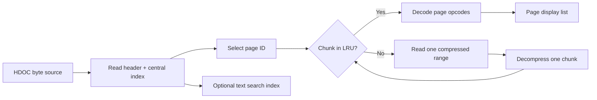

# HyperDoc Decoder

<p align="center">
  <a href="https://github.com/younsabood/hdoc-decoder"></a>
  
  
  <a href="LICENSE"></a>
</p>

Read HyperDoc (`.hdoc`) files with indexed page access, lazy chunk decoding,
asset access, and full-text search. This crate is an independent Rust
repository: it owns its format reader and has no dependency on `hdoc-encoder`.

> [!NOTE]
> The decoder produces a page display list. It does not include a PDF parser,
> image codec, or graphics renderer.

## Explore

| Guide | What it covers |
| --- | --- |
| [Quick start](docs/quickstart.md) | Open a file and read a page or search text |
| [API reference](docs/api.md) | Document, source, cache, and search APIs |
| [Architecture](docs/architecture.md) | Lazy reads, validation, decompression, and cache |
| [File format](docs/format.md) | Header, central index, chunks, and opcodes |
| [Diagrams](docs/diagrams/README.md) | Mermaid source diagrams (`.mmd`) |

## Capabilities

| Feature | Details |
| --- | --- |
| Random page access | Reads the index at open and decompresses only the requested page chunk. |
| Input sources | Use a memory map, an in-memory buffer, or implement `ByteSource`. |
| Bounded chunk cache | Reuses recently decoded chunks through an LRU cache. |
| Search | Reads the optional Unicode text index without decoding page graphics. |
| Borrowed assets | Returns asset bytes as a borrowed slice when the source permits it. |
| Validation | Checks header, footer, index ranges, checksums, limits, and page references. |

## Read path



Editable diagram source: [reader-flow.mmd](docs/diagrams/reader-flow.mmd).

## Quick example

Add the crate from GitHub:

```toml
[dependencies]
hdoc-decoder = { git = "https://github.com/younsabood/hdoc-decoder" }
```

Open a file and read one page:

```rust,no_run
use hdoc_decoder::HdocDocument;

fn main() -> Result<(), Box<dyn std::error::Error>> {
    let document = HdocDocument::open("example.hdoc")?;
    println!("pages: {}", document.page_count());

    let page = document.page(0)?;
    println!("first page: {} x {}", page.width, page.height);
    if let Some(text) = document.page_text(0)? {
        println!("{text}");
    }
    for result in document.search("example")? {
        println!("match on page {}", result.page_id);
    }
    Ok(())
}
```

`HdocDocument::from_bytes` reads an in-memory buffer. For a custom or range
source, implement `ByteSource` and open it with `HdocDocument::from_source`.

## Display and assets

SVG fallback and template commands are materialized in the returned page list.
Consumers can pass vector SVG and drawing commands to their own rendering
backend. Image and vector assets are available through `asset_bytes`. See the
[API reference](docs/api.md) and [format guide](docs/format.md).

## Community and license

| Resource | Purpose |
| --- | --- |
| [MIT License](LICENSE-MIT) · [Apache 2.0](LICENSE-APACHE) | Dual license, at your option |
| [Contributing](CONTRIBUTING.md) | Local checks and pull requests |
| [Code of Conduct](CODE_OF_CONDUCT.md) | Community expectations |
| [Security policy](SECURITY.md) | Private vulnerability reporting |

The project is licensed under either [MIT](LICENSE-MIT) or [Apache 2.0](LICENSE-APACHE), at your option.
